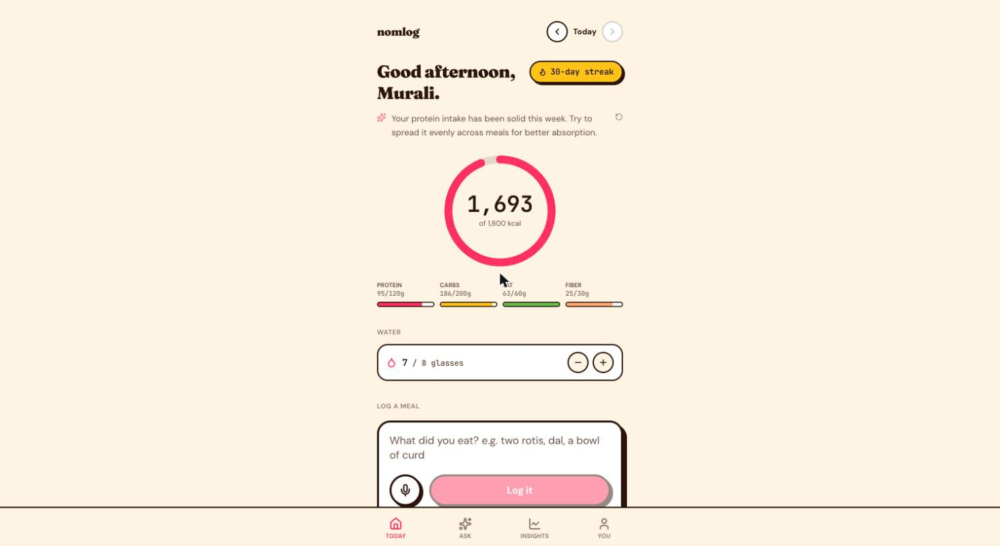
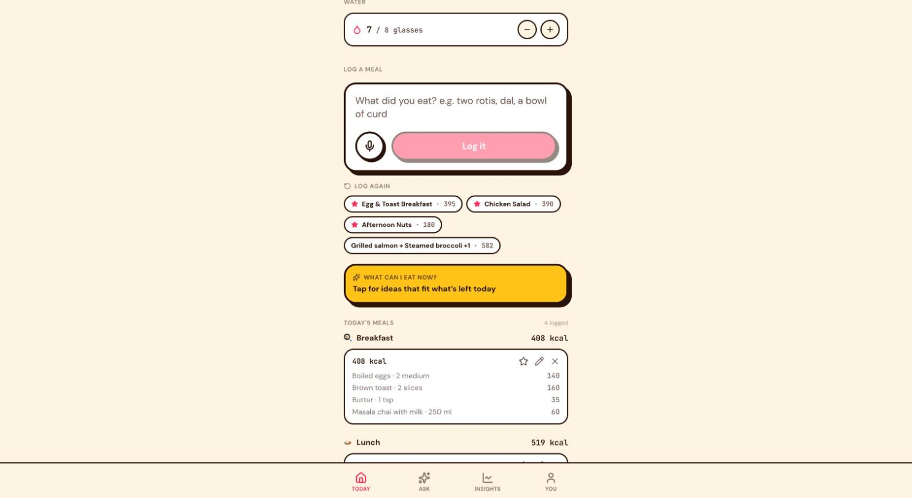
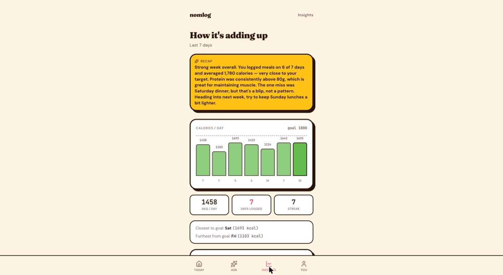
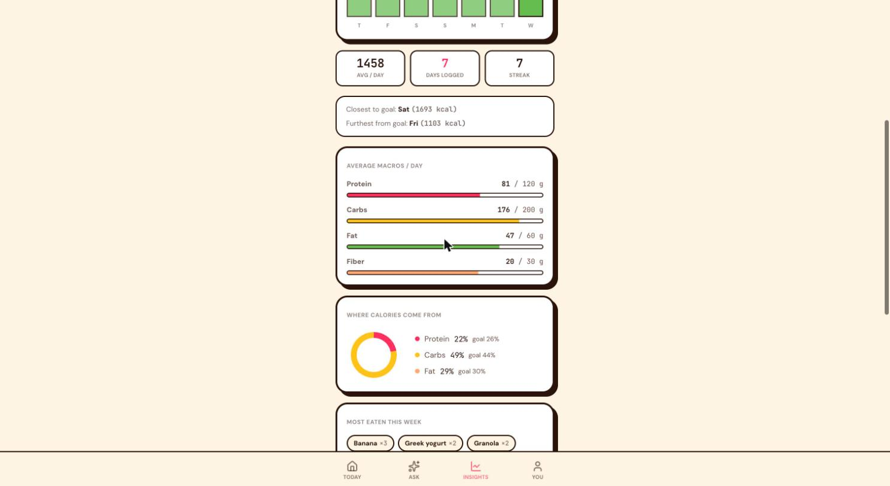
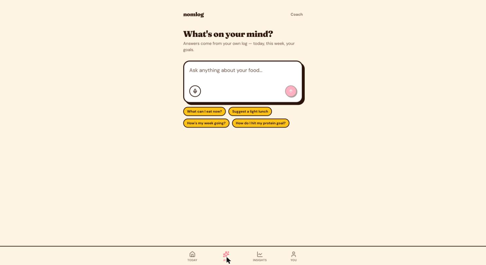
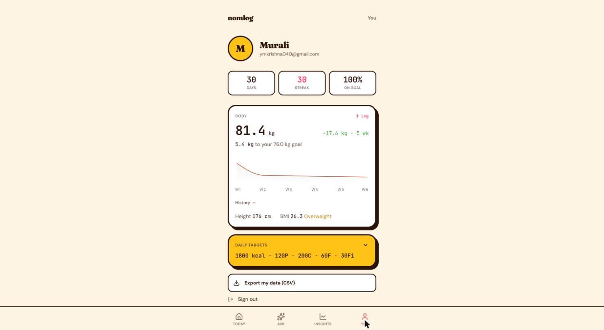

# NomLog

Voice-first food logging. Just say what you ate — NomLog extracts the calories and macros, tracks your goals, and tells you how you're doing.

**Live app:** [nomlog-neon.vercel.app](https://nomlog-neon.vercel.app)

---

## Screenshots

| Dashboard | Today's Meals |
|---|---|
|  |  |

| Insights | Macro Breakdown |
|---|---|
|  |  |

| Coach | Profile & Weight |
|---|---|
|  |  |

---

## Features

- **Voice logging** — describe a meal in plain words; Gemini extracts every item, portion, and macro
- **Daily dashboard** — calorie ring, macro bars, water tracker, AI tip, and quick re-log from favourites
- **Insights** — 7-day calorie bar chart, average macros vs goals, macro split donut, most-eaten foods, monthly calendar
- **Coach tab** — ask anything about your log ("what can I eat now?", "how's my protein this week?")
- **Profile** — weight trend chart, BMI, goal weight progress, daily targets, CSV export
- **iOS app** — native companion app in `NomLog-iOS/` backed by this server

---

## Stack

| Layer | Tech |
|---|---|
| Frontend | Next.js 15 (App Router), Tailwind CSS |
| Backend | Next.js API routes, Supabase Edge Functions |
| Database | Supabase (Postgres) + Row-Level Security |
| Auth | Supabase Auth — Google + Apple sign-in |
| AI | Google Gemini (meal parsing, tips, coach, recaps) |
| iOS | Swift, hosted at `NomLog-iOS/` |
| Deploy | Vercel (web) |

---

## Running locally

### Production build (use for iOS simulator testing)

```bash
npm run build && npm start
```

Serves at `http://localhost:3000`. The iOS simulator points here by default.

### Dev mode (use while editing web code)

```bash
npm run dev
```

Hot reload. If it hangs, delete `.next` and retry.

---

## Environment variables

Copy `.env.example` to `.env.local`:

| Variable | What it is |
|---|---|
| `NEXT_PUBLIC_SUPABASE_URL` | Supabase project URL |
| `NEXT_PUBLIC_SUPABASE_ANON_KEY` | Supabase anon (public) key |
| `SUPABASE_SERVICE_ROLE_KEY` | Supabase service-role key (server-only) |
| `GEMINI_API_KEY` | Google Gemini API key |
| `NEXT_PUBLIC_SITE_URL` | The app's public URL (auth redirects) |

---

## Deploying to Vercel

1. Push to GitHub and import at [vercel.com/new](https://vercel.com/new) (Next.js auto-detected).
2. Add all env vars above in Vercel project settings. Set `NEXT_PUBLIC_SITE_URL` to your Vercel URL.
3. In Supabase → Authentication → URL Configuration, add the Vercel URL to redirect URLs.
4. Deploy. For the iOS app, update `apiBase` in `NomLog-iOS/NomLog/App/SupabaseConfig.swift` to the Vercel URL.

> Gemini free tier: ~20 requests/day/model. Tips and recaps are cached server-side (one per day/week per user) to stay under the limit.

---

## Demo seed

To populate a Supabase user with 30 days of realistic demo data:

```bash
SEED_EMAIL=your@email.com node scripts/seed-demo.mjs
```

Requires `SUPABASE_SERVICE_ROLE_KEY` in `.env.local`. Seeds 30 days of meals, weight trend, water, daily tips, weekly recaps, and favourite meals for the given user.
